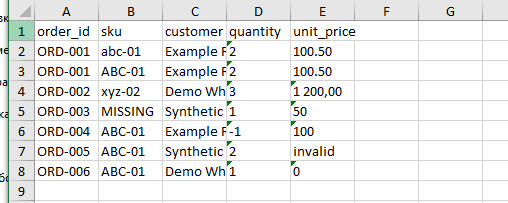
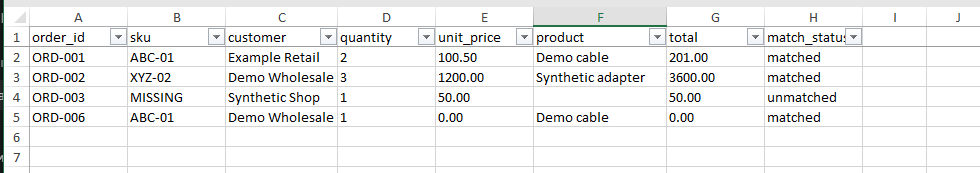
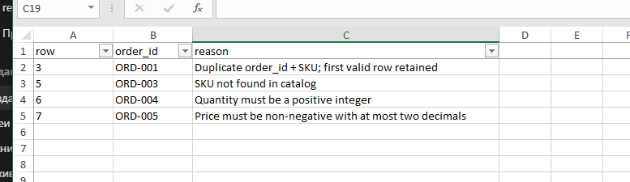

# Sheet Studio: от исходной таблицы к проверяемому отчёту

Демонстрационный проект портфолио. Все названия компаний и исходные данные синтетические. Скриншоты получены при ручной проверке пользователем в Excel. Проект не представлен как коммерческий заказ; экономия времени и денег не измерялась.

## Задача

Подготовить таблицу продаж к дальнейшей работе: проверить значения, убрать повторные позиции, сопоставить артикулы с каталогом и выделить ошибки для ручной проверки. Запуск доступен через командную строку и локальную веб-форму; платные API не нужны.

## До обработки

В семи строках примера есть повтор заказа и артикула, разные регистры SKU, отрицательное количество, некорректная цена и артикул, которого нет в каталоге.



## После обработки

Приложение нормализует артикулы, проверяет поля, сохраняет первую валидную позицию по ключу `order_id + sku`, подставляет название товара из каталога и рассчитывает сумму позиции.



| Показатель | Результат примера |
| --- | ---: |
| Входные строки | 7 |
| Принятые строки | 4 |
| Отклонённые строки | 3 |
| Позиции, найденные в каталоге | 3 |
| Неизвестные артикулы | 1 |
| Общая сумма принятых строк | 3851.00 |

Сумма: 201.00 + 3600.00 + 50.00 + 0.00. Валюта в примере не задана.
Неизвестный артикул `MISSING` сохранён со статусом `unmatched`, а его 50.00 входят в общую сумму. Это явно выбранное правило демо, которое необходимо согласовывать для каждой клиентской задачи.

## Проверяемые замечания

Отдельный лист содержит четыре замечания: повтор позиции, неизвестный артикул, отрицательное количество и некорректную цену. Три строки отклонены; неизвестный артикул требует проверки, но остаётся в принятых данных.



## Как повторить

Из корня репозитория после установки по README:

```powershell
.venv/Scripts/python.exe -m studio.cli examples/orders.xlsx examples/catalog.xlsx --output reports
.venv/Scripts/python.exe -m unittest discover -s tests -v
```

Либо запустите `python -m studio.web` в установленном окружении, откройте локальную форму, выберите оба файла и скачайте ZIP.
В результате формируются `cleaned.csv`, `issues.csv`, `summary.json` и `report.xlsx` с листами Cleaned, Issues, Summary. Готовый пример доступен в [demo-results](../demo-results/).

## Границы демонстрации

Точное сопоставление по SKU после нормализации; один каталог, одна таблица заказов, одна валюта на вход. Нечёткое сопоставление и вычисление формул Excel не реализованы. Входная схема фиксирована; изменение колонок и правил требует настройки кода. Веб-интерфейс предназначен для локального использования. Принятые строки могут требовать дополнительной проверки, если SKU не найден.

## Для обсуждения с заказчиком

Перед адаптацией нужны обезличенный образец таблиц, требуемые выходные колонки, правило обработки дублей, политика неизвестных артикулов, валюта, объём данных и критерии приёмки. Стоимость и срок определяются после проверки этих условий.
